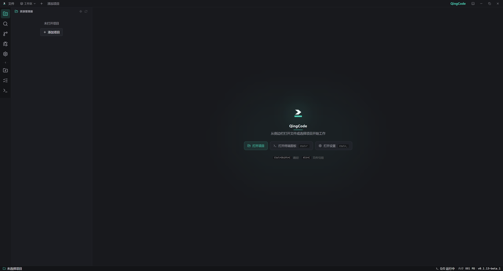
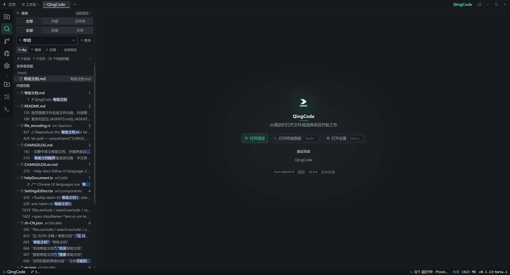
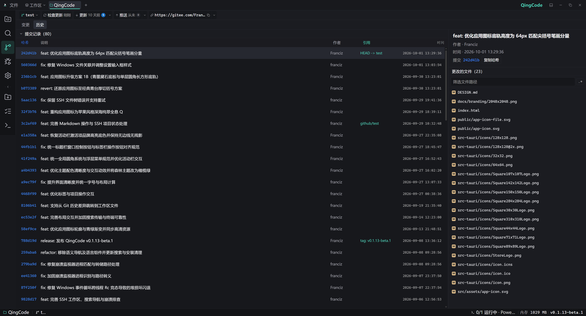
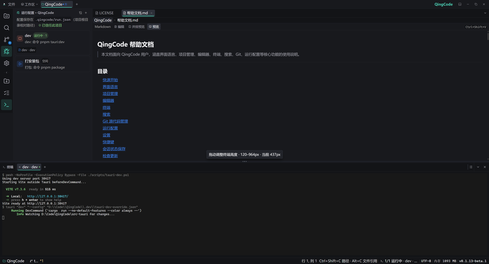
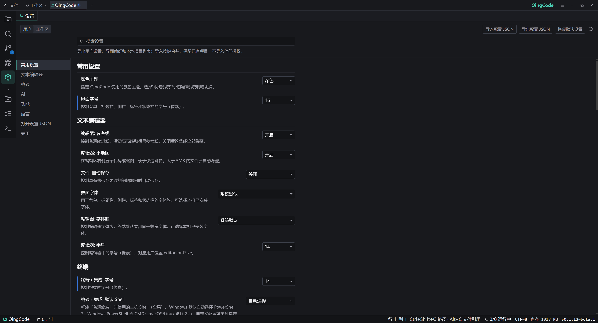
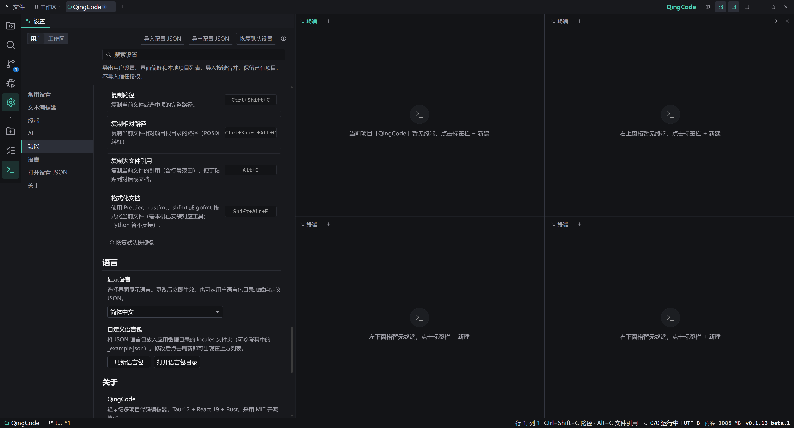
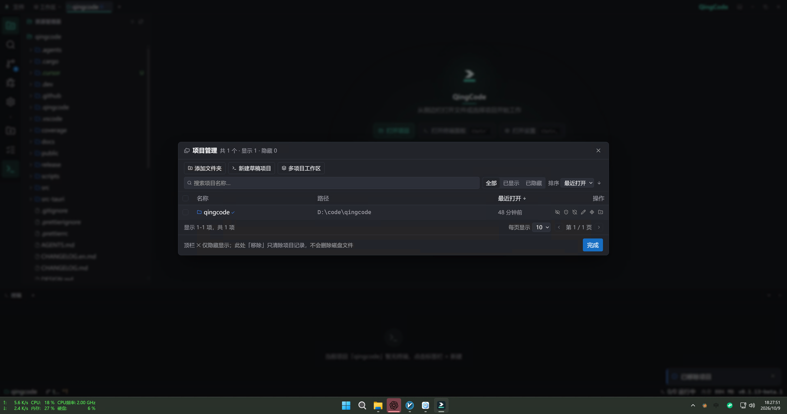
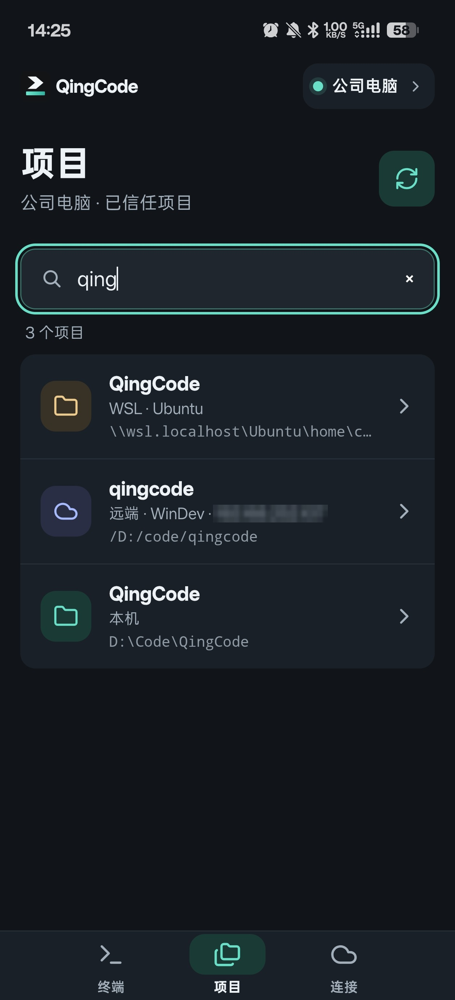
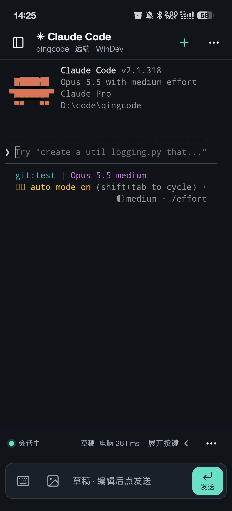
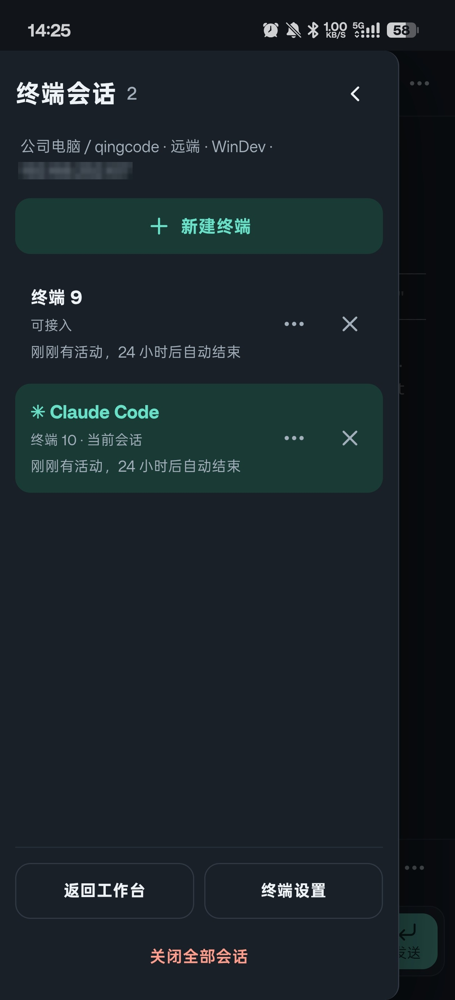

# QingCode

[English](./README.en.md)

**QingCode** 是 AI 开发时代下的**代码项目管理搭子**：把多项目切换、服务启动、终端现场和轻量编辑放进同一个桌面窗口。  
不是再做一个 VS Code / Zed，而是补上「同时盯多个项目、一键拉起前后端与工具链」这件事。

桌面之外，**QingCode Android** 把这套终端现场延伸到手机：连回同一台 Windows 电脑，继续同一批项目与会话，出门也能盯着 AI 干活。

## 核心优势

| 优势 | 能帮你做什么 |
|------|--------------|
| **切项目不丢现场** | 多个项目钉在标题栏，单击切换；未保存内容和正在跑的终端都还在，重启应用也能恢复会话 |
| **一键拉起整套服务** | API、前端、Worker 写进一份运行配置，每个任务一个终端，可整组启停；还能从 `package.json` 发现候选命令 |
| **本机与远程同一套操作** | 本机、WSL、SSH 和 Server 直连项目放在同一个工作区，文件树、终端和全局搜索都不用换工具；Windows 远端能力见[下文](#ssh-远程工作区) |
| **断线、退出都能接回** | 远端服务托管终端，网络中断后回到原会话；Windows 本地 PowerShell / CMD 默认由后台宿主托管，退出 QingCode 后进程继续跑，下次按原 PTY 接回 |
| **手机接回真实终端** | 手机上看到的就是电脑上那个 CLI，可以继续输入、看输出、传图片，不用等第三方客户端适配 |
| **AI 工具随你选** | 不内置模型，也不改写、代理 AI 服务；Claude Code、Codex、OpenCode 用的还是官方 CLI，账号和请求都留在 CLI 内 |
| **Agent 能操作 QingCode** | Agent 可通过 CLI + Skill 管理项目、改运行配置、启停服务并读取 JSON 结果 |
| **推送后多端自动对齐** | 可选的 Git 多端同步：一个项目推送后，同一仓库的其他本地 / SSH 项目自动快进到最新提交 |
| **陌生代码先过信任这一关** | 未信任的项目不能跑脚本和终端；SSH 主机指纹变化要重新确认，远程操作限定在项目根目录内 |
| **原生外壳，够用就好** | 基于 Tauri 2 与 Rust，使用系统 WebView，不捆绑 Chromium；不做后台语义索引，也没有插件市场 |

需要类型推断、重构或断点调试时，请搭配 IDEA / VS Code / Zed，取舍见[日常使用对比](#日常使用和-idea--vs-code--zed-的差异)。

## 界面预览

以下为中文界面实拍，点击图片可查看原图；桌面截图为原始 PNG，手机截图为原始 JPEG。截图中的版本号为拍摄时版本，手机截图中的网络地址已打码。

### 欢迎页与项目入口

从欢迎页打开项目、进入终端或设置；标题栏集中管理工作区与项目切换。

[](./docs/screenshots/zh-01-welcome.png)

### 全局搜索

按范围搜索目录、文件名和文件内容，分类展示匹配结果，支持大小写、模糊匹配、后缀与文件类型筛选。

[](./docs/screenshots/zh-02-search.png)

### 源代码管理

在整页工作台浏览提交历史、引用与变更文件，通过顶部工具栏检查更新、拉取和推送。

[](./docs/screenshots/zh-03-source-control.png)

### 运行配置与 Markdown 预览

左侧管理项目运行配置，底部保留任务终端；编辑区可切换 Markdown 编辑、并排预览或单独预览。

[](./docs/screenshots/zh-04-run-config-markdown.png)

### 设置

分别管理用户与工作区设置，调整主题、字号、字体和终端环境，也可导入、导出配置或恢复默认设置。

[](./docs/screenshots/zh-05-settings.png)

### 四终端布局

将终端分成 2×2 窗格，同时保留设置或编辑器列，适合并排观察多组服务与 AI CLI。

[](./docs/screenshots/zh-06-four-terminals.png)

### 项目管理

搜索项目名称或路径，按显示状态筛选与排序，集中添加、隐藏或移除项目记录。

[](./docs/screenshots/zh-07-manage-projects.png)

### 手机版（Android）

从连接电脑、搜索项目和终端会话，到接回电脑上的 AI CLI，手机端保留完整的终端操作现场。

<table>
  <tr>
    <td width="50%" align="center">
      <a href="./docs/screenshots/zh-mobile-01-connections.jpg"></a><br>
      <sub>连接：扫码配对并切换已保存的电脑</sub>
    </td>
    <td width="50%" align="center">
      <a href="./docs/screenshots/zh-mobile-02-projects.jpg"></a><br>
      <sub>项目：搜索电脑上已信任的本机、WSL 与远端项目</sub>
    </td>
  </tr>
  <tr>
    <td width="50%" align="center">
      <a href="./docs/screenshots/zh-mobile-03-terminal.jpg"></a><br>
      <sub>终端：接回同一 AI CLI 会话，继续输入或查看输出</sub>
    </td>
    <td width="50%" align="center">
      <a href="./docs/screenshots/zh-mobile-04-sessions.jpg"></a><br>
      <sub>会话：在侧栏切换、重命名或结束手机终端</sub>
    </td>
  </tr>
</table>

## 为什么做 QingCode

写代码越来越常和 AI 结对（Cursor、Claude、OpenCode 等），真正拖慢节奏的往往不是「缺一个更重的 IDE」，而是：

- 本地与远程同时挂着好几个仓库 / 业务目录，来回切窗口丢现场
- 每个项目要起的服务一长串（API、前端、Worker、代理……）命令记不住、终端乱成一团  
- AI 助手、脚本和本机进程各自为政，项目管理仍靠自己拼凑  

QingCode 把重心放在**项目管理与运行现场**：多项目常驻、终端跟项目走、用运行配置一键拉起服务；编辑、搜索、看 Git 差异够用即可，复杂智能交给你已有的 AI 工具。

## 核心能力

### 多项目随手切换

把常用的本地目录、SSH 或 Server 直连项目钉在标题栏，单击切换。每个项目自带文件树与终端；切走不会清掉未保存缓冲和终端现场。项目多了会自动收纳，也可保存为命名多项目工作区。

项目管理支持按名称或路径搜索、显示 / 隐藏筛选和排序。标题栏的关闭按钮只隐藏项目；项目管理中的「移除」清除项目记录，不删除磁盘文件，之后仍可重新添加。

### SSH 远程工作区

通过标题栏 `+` → **SSH** 连接远程主机：首次连接确认主机指纹，认证后浏览并选择远程项目目录。连接配置与项目分开保存，无口令私钥可在应用重启后自动重连。会话定期保活，空闲不会被拆掉。

Linux / POSIX 远端支持 SFTP 文件操作、远程 PTY 终端、Git 工作台、格式化、运行配置，以及与本地项目混合的多项目搜索。Windows OpenSSH 可打开盘符路径上的项目，终端按配置启动 PowerShell 或 CMD，提示符出现时已经在项目目录。Windows 远端可用文件操作和与本机互传；远程 Git、搜索、格式化和运行任务不可用。

- 把本机文件或文件夹拖到 SSH 文件树即可上传：文件夹落到该目录，文件落到父目录，空白处和项目标题落到项目根。
- `terminal.integrated.sshUploadOnPaste` 默认开启：在 SSH 终端粘贴或拖入本机文件会先上传到项目 `.qingcode/terminal-paste/`，再粘贴远端路径。超过 100MB 的文件或文件夹会被拒绝；设置页和终端右键可清理该目录。上传成功后不保留传输任务条。

写入、终端和命令执行仍受工作区信任保护。当前不提供远程扩展、端口转发或 SSH Agent 转发。能力对照与边界见 [SSH 工作区](./docs/ssh-workspaces.md)。

### Server 端口直连

通过独立 TLS 端口连接远端 `qingcode-server`，HTTPS 文件操作与 WSS 终端共用一个端口，日常通信直接到远端，无需 SSH 隧道。可在「远程连接 → 新建 Server 直连」中独立添加，也可在已有 SSH 连接的「Server 端口直连」面板中安装或导入服务。

远端准备好 `qingcode-server` 后，以日常开发账户启动并导出配对信息：

```text
qingcode-server direct --hostname 0.0.0.0 --port 48763 --detach
qingcode-server direct-info --include-secret
```

将输出的配对 JSON 导入界面，填写远端实际 IP 或域名，开放 TCP 端口后点击「测试直连」，核对证书指纹，再「保存并启用直连」。配对 JSON 含认证凭据，请勿分享。`--detach` 让服务脱离当前终端运行，机器重启后仍需重新启动或自行配置开机启动。

- **固定默认端口，可修改**：默认 `48763`，端口占用时明确报错。修改时须同步调整远端监听和防火墙 / NAT 映射；保留最近 8 个历史端口供核对，不自动回退或删除旧规则。
- **通过 SSH 授权放行**：选择同主机且已确认指纹的 SSH 连接，先检查 Windows 管理员权限，再确认 TCP 端口、来源 IP、接收地址和实际网络范围（含 Public）。授权后写入专属规则并探测端口；规则已写入与端口可达分别反馈。也可复制命令手动配置，上层防火墙及网关映射仍需另行处理。
- **断线后接回终端**：网络断开或直连入口重启时，仍存活的远端 daemon 会保留 PTY，重连后接回原会话。明确关闭终端、进程退出或机器重启仍会结束会话。原有 SSH 连接方式继续保留。

完整配对、端口变更、会话边界与部署说明见 [Server 端口直连](./docs/direct-agent.md)。

### 安卓移动版：把终端现场带到手机

QingCode Android 是**终端优先的远程控制器**，不是另一个手机 IDE。手机通过局域网或 Tailscale 等虚拟组网连接 Windows 上运行的 QingCode，直接打开电脑端已添加并信任的项目——本机、WSL、SSH 与 Server 直连都在同一列表里；选一个项目，就能接回电脑上的终端现场。

为什么坚持用终端，而不是做一个「手机版 AI 客户端」：

- **原汁原味**：手机上运行的就是电脑上的同一个 CLI、同一个 TUI、同一套配置与快捷键。Claude Code、OpenCode、Codex 等怎么在终端里用，手机上就怎么用；CLI 更新后，新能力也直接可用，不必等第三方客户端跟进适配。
- **没有魔改，不额外引入风控风险**：QingCode 不改写、不注入、不代理任何 AI 服务的客户端或协议，只负责把真实终端画面和按键搬到手机。账号、模型、额度与请求始终留在官方 CLI 内，和坐在电脑前敲命令走同一条链路，不会因为「第三方客户端魔改」多出一层账号风险。
- **现场留在电脑上**：终端会话由 Windows 端托管。手机短暂离线、切换电脑或重开 App 都不会中断正在运行的任务；回来时接续原会话，继续看输出、补输入。
- **为手机重做的操作层**：扫码配对、多电脑切换、常用快捷键栏、中文输入与粘贴、图片上传、历史回看与输出搜索、字号调整与横屏沉浸；桌面端负责 SSH / Server 凭据和项目信任，手机只在已授权范围内操作终端。

连接方式：Windows 端打开 **设置 → 移动连接**，设置端口与密码并启用，再用手机扫码或在「连接」中粘贴配对链接。电脑更换端口后，手机沿用原配对迁移到新端口，无需重新配对。手机与电脑需网络互通，Android 8.0+。完整配对、会话与安全边界见 [Android 移动端说明](./mobile/README.md)。

### 运行配置：管好项目里的服务启动

这是 QingCode 的核心工作流之一。为每个项目配置一组「运行配置」（保存在 `.qingcode/run.json`）：

- 一个配置可包含多个任务（命令 / 脚本 / ps1 / bat / sh）  
- 一键启动时，**每个任务开一个终端**，适合同时拉起 API、前端、Worker 等  
- 支持工作目录与环境变量；可停止整组配置  
- 每个配置可决定是否跟随项目会话恢复，默认关闭；开启后重启应用会恢复并重启其关联终端
- 陌生项目默认受限，信任后才能编辑、跑脚本和使用终端  

日常用法：打开项目 → 运行配置里点启动 → 服务进各自终端 → 再去改代码或把终端交给 AI CLI。

同一个 `dev` 可通过任务内 `os.windows/linux/macos` 覆盖命令、目录和环境变量，公共字段作为默认值；WSL 自动使用所属发行版的 Linux 工具链，SSH 以远端系统为准。旧配置与 CLI 语法继续兼容，详见[跨平台运行配置](docs/run-config.md)。

运行面板支持「发现运行配置」：从项目根目录和直属子目录的 `package.json scripts` 生成候选命令，勾选后导入，也可合并为多终端配置。发现过程仅读取文件，运行继续遵循工作区信任规则。

### 本地终端接回

「设置 → 终端 → 集成: 本地终端可接回」默认开启：Windows 本地 PowerShell / PowerShell 7 / CMD 交互终端由后台宿主托管。退出时可选择「保留本地终端并退出」，关闭或升级 QingCode 后进程继续运行，下次打开按原 PTY 接回。宿主连续断开 24 小时自动结束终端，电脑重启后标签按原配置重新启动。WSL、一次性运行任务与手机端新建的终端仍由 QingCode 进程持有。边界与迁移见 [终端工具](./docs/terminal-tools.md#本地终端接回)。

### 终端配置：默认环境与 AI / 工具入口

除了运行配置，还可管理**终端配置文件**（名称 + 启动命令）：

- 默认用 PowerShell，或一键进入自定义环境  
- 把常用 AI / 开发 CLI（如 `opencode`）写成配置，右键「+」选用  
- 终端默认落在项目根目录；换项目时已有终端不会被关掉  

运行配置管「项目服务怎么起」，终端配置管「这个壳默认跑什么」——两者一起，把本地与远程的多项目现场收拢到一处。

### 面板布局：经典底栏或侧栏多列

标题栏提供**面板布局**菜单（快捷键可循环），默认是**经典布局**（终端在底部）。也可切到侧栏旁工作区：

| 布局 | 说明 |
|------|------|
| 经典布局（终端在底部） | 编辑器为主，终端可拖高度 |
| 编辑器+终端 | 侧栏旁编辑器 \| 终端，默认可拖成约 1:1 |
| 编辑器+双终端 | 编辑器 \| 终端 A \| 终端 B，默认约 1:1:1；中间与左侧分隔都可拖（约 10%–90%） |
| 终端工作台（左侧列表） | 面向 AI 编码：左侧终端列表 \| 当前终端 \| 编辑器，打开文件时编辑器才出现在终端右侧 |

双终端两侧各自有标签栏，标签过多时用下拉查看全部。侧栏布局下可在顶栏布局菜单中切换双终端、田字四终端，顶栏布局按钮左侧可显示或隐藏编辑器；四终端以 2×2 排列并可拖动十字分隔。打开文件 / 源代码管理 / 设置时会显示编辑器列，但不会关掉双终端或四终端。

终端工作台的左侧列表支持搜索、运行中优先、按来源筛选和分组拖动排序，每行显示来源与最后活动时间，待恢复终端以弱化小点标记；管理模式可批量处理会话。Git 与设置在该布局下作为侧栏整页视图显示。

终端标签上的呼吸点表示程序正在工作（标题在转圈，或持续有输出），默认开启，可在 **设置 → 终端 → 标签运行状态** 关闭。详细边界见 [DESIGN.md](./DESIGN.md)。

### 与 AI 协作：外挂助手，不内置模型

QingCode **不内置**聊天模型或 Agent，刻意把智能留给你已有的 Cursor / Claude / OpenCode 等工具，自己专注多项目与运行现场：

- **终端里跑 AI CLI**：用终端配置一键进入 `opencode` 等；运行配置拉起的服务终端也可直接交给助手操作  
- **复制给对话用**：资源管理器 / 编辑器可复制路径、相对路径或「文件引用」（含行号），方便贴进 AI 对话  
- **QingCode CLI + Skill**：设置 → **工具与集成** →「复制 skills 文本」，把可安装的 Skill 说明拷到剪贴板，按你 Agent 的方式自行安装（例如存成 `SKILL.md`）。Agent 可通过 `QingCode.exe` 子命令列/加项目、读写运行配置、在 GUI 已启动时切换项目、启停运行配置、授权信任、打开文件等（JSON 输出）。QingCode **不会**自动注册或适配任何 Agent  

典型配合：QingCode 管项目与服务 → AI 在终端或外部 IDE 里改代码 → 需要时用 CLI / 引用把现场接回 QingCode。

### 干净的文件树与轻量编辑

资源管理器只展示当前项目。可在树里新建、重命名、删除；复制路径、相对路径、文件引用，或「复制文件到剪贴板」粘到资源管理器 / 支持文件粘贴的应用；也可在指定目录打开终端或搜索。默认显示项目中的全部条目，包括构建产物、依赖目录和被 `.gitignore` 忽略的内容；可用 `files.exclude` 或 `explorer.excludeGitIgnore` 按需隐藏。磁盘变更会自动刷新已展开目录，工具栏刷新同样会重扫展开子树。

多文件标签编辑，常见语言按需高亮；自动识别 UTF-8 / BOM / GB18030 兼容编码；外部改动可分类处理，避免悄悄覆盖。大文件会降级或只读预览。重启后恢复各项目的编辑与终端会话（打开项目时不再自动新建空终端）。

文件导航提供 `Ctrl+P` 按文件名查找、`Ctrl+Shift+F` 全文搜索、`Ctrl+G` 转到行，以及 `Alt+Left` / `Alt+Right` 后退 / 前进。`Ctrl+Shift+O` 打开当前文件的函数、类或标题列表，点击搜索结果可定位到对应行列。

QingCode 专注于多项目、SSH、文件编辑和终端工作流；本地与 SSH 工作区均不提供语义定义跳转、引用查找或工作区符号搜索，也不运行后台语义索引。语法高亮、代码折叠和当前文件结构由编辑器提供，无需安装独立导航语言组件。类型分析、重构和调试可使用 IDEA、PyCharm 等完整 IDE。

### 源代码管理：整页工作台

活动栏进入源代码管理后，主编辑区整页展示（再点一次回到资源管理器）：

- **变更**：区分已暂存 / 未暂存；支持单个或全部暂存与取消暂存、丢弃更改（二次确认）、提交已暂存内容，以及检查远程更新（fetch）、拉取 / 推送（使用已配置 upstream）
- **历史**：浏览提交记录，查看变更文件与逐文件差异  
- 右侧内嵌 Diff；中文、空格、重命名路径按原始路径读取；拉取后若有冲突会提示，冲突解决仍在编辑器中完成  

复杂的分支整理、rebase、冲突合并器等仍可在你熟悉的 Git / AI 工具里完成。

### 搜索与定制

按范围搜文件名或文件内容；内容搜索默认收起替换区，需要时再展开。深色 / 浅色 / 烟墨 / 护眼绿 / 跟随系统；界面与代码字体可调；界面语言支持简体中文与 English。全局 `default-settings.json` 与项目 `.qingcode/project-settings.json` 为 **JSON5**，模板注释标明不得删除注释（详见 [帮助文档 · 设置](./帮助文档.md#设置)）。

### Git 多端同步

在 **设置 → Git 多端同步** 中开启后（默认关闭），一个项目推送成功，QingCode 会按归一化 remote URL 与分支，找到同一仓库中开启「自动接收」的其他本地或 SSH 项目，执行 fetch、安全检查和 `merge --ff-only`，并刷新状态与已打开的文件。项目按机器并行处理、优先当前项目，无法快进时给出本地化提示而不强行合并。详见 [Git 多端同步](./docs/git-push-sync.md)。

### 配置迁移与恢复默认

设置顶部可按当前用户或工作区范围导入、导出配置 JSON，或恢复默认设置。用户导出包含全局设置、界面偏好、快捷键、终端配置和本地项目列表；工作区导出仅包含该项目的覆盖项。导入按键合并并保留 JSON5 注释，本地项目按路径合并；导出不包含 SSH 凭据、信任授权和会话数据。

界面、QingCode CLI 与 AI CLI Skill 使用同一套配置迁移流程，CLI 提供 `settings export`、`settings import` 与 `settings reset --yes`。恢复用户默认设置保留项目记录，恢复工作区默认设置则重新继承用户配置。完整格式与命令见 [配置导入与导出](./docs/settings-transfer.md)。

## 日常使用：和 IDEA / VS Code / Zed 的差异

| 日常场景 | QingCode | IDEA | VS Code | Zed |
|--|--|--|--|--|
| 最适合做什么 | 同时管多个项目、服务和终端现场 | 深度开发、重构、调试 | 按扩展拼装的通用开发 | 轻快编辑与 LSP 开发 |
| 切项目后 | 标题栏常驻，编辑与终端现场保留 | 以项目 / 窗口为中心 | 以工作区为中心 | 以工作区为中心 |
| 代码导航 | 文件搜索、全文搜索、当前文件结构与前进后退；无语义跳转或引用查找 | 编译器级语义、重构与调试 | 主要随语言服务器和扩展而定 | 主要随语言服务器而定 |
| 扩展与 AI | 无市场、不内置模型；终端 + CLI 对接外部助手 | 插件生态与 AI 插件 | 扩展生态最广 | 内置 AI 倾向、生态较小 |

常见搭配：先在 QingCode 一键启动 API、前端和 Worker，切项目时保留现场；需要类型推断、重构或断点调试时，再用 IDEA / VS Code / Zed 打开同一仓库。QingCode **刻意不做**完整 IntelliSense、调试器和插件市场。

## 典型用法

1. 添加几个本地目录、SSH 或 Server 直连项目，钉在标题栏
2. 为常用项目写好运行配置（例如 `dev` = API + Web）  
3. 需要时一键启动服务，终端按任务分开；可用双终端或田字四终端同时观察多路输出
4. 用终端配置进入 AI CLI，或从设置复制 CLI Skill 给 Agent  
5. 在标题栏切到下一个项目——编辑与终端状态仍在  
6. 离开电脑时用 QingCode Android 扫码接回，继续同一终端里的输入与输出

## 适合谁

- 同时维护多个本地仓库，又要经常起停服务的人  
- 已经在用 AI 编程工具，需要一个更稳的本机项目 / 进程搭子  
- 不想为「切项目 + 起服务」再开一整套重型 IDE 的人  
- 经常离开电脑，却想用手机继续盯 AI CLI、服务日志或远程构建的人

## 获取应用

从 [GitHub Releases](https://github.com/Fracizz/QingCode/releases) 或 [Gitee Releases](https://gitee.com/FrancizTest_admin/qing-code/releases) 下载（打 `v*` 标签后由 CI 构建）：

| 平台 | 架构 | 推荐文件 |
|------|------|----------|
| Windows | x64 | `QingCode_*-windows-x64-setup.exe`（推荐）或便携 `.exe` |
| Windows | ARM64 | `QingCode_*-windows-arm64.exe` |
| macOS | Apple Silicon (arm64) | `QingCode_*-macos-arm64.dmg` 或 `.zip` |
| Android 8.0+ | 通用 | `QingCode_<版本>-android.apk`（需配合 Windows 桌面端） |

- Windows：便携 exe 或 NSIS 安装包（`*-setup.exe`）；首次安装会显示安装目录，点击「开始安装」后才执行；检测到旧版本时在原目录自动覆盖升级，无需先卸载。同版本重装默认也需确认。配置和项目记录保留，完成页的「运行QingCode」默认勾选，可取消。升级或卸载时，如果当前安装目录的应用正在运行，会先弹窗确认：选择「是」强制关闭（不经过应用内保存提示，未保存内容可能丢失，请先保存），选择「否」则停止本次操作；其他目录的 QingCode 不受影响。`/S` 可完全静默安装，只有显式传入 `/R` 才在静默安装后启动；静默模式下应用仍在运行时不会强制关闭，而是中止并返回退出码 2。需 [WebView2](https://developer.microsoft.com/microsoft-edge/webview2/)（较新系统通常已预装）；缺失时自动下载安装，失败时提供下载入口。升级也会清理旧版导航组件文件，保留组件目录中额外存放的文件。
- Windows 安装包和便携版都不内置 `servers/`；两者共用独立的 `QingCode-servers.zip` 或在线下载。需要离线使用时，将 zip 中的 `servers/`（含 `manifest.json`）放到安装目录或 exe 同目录。本地 `pnpm package` / `package:exe` 默认构建并校验服务包；`-SkipServer` 仅跳过编译，仍校验并发布当前版本产物，旧版本或损坏文件会阻止打包。
- 打包默认覆盖项目根目录相对路径 `release/servers/` 中的同名二进制和 `manifest.json`，清理旧架构服务文件并重新生成 `release/QingCode-servers.zip`，保留目录中的其他文件。路径不依赖调用者当前目录，也不绑定某台机器的绝对路径。
- macOS：未签名时首次请右键 → 打开；需要 Apple Developer 签名/公证后再分发可跳过该步骤  
- Android：APK 为通用包，需 Android 8.0+，连接 Windows 上运行中的 QingCode（同一局域网或 Tailscale 等虚拟组网）。首次使用先在电脑端启用「Android 移动连接」并扫码配对；仅通过 Releases 分发，覆盖安装即可升级，发布签名保持一致。详见 [Android 移动端说明](./mobile/README.md)。

本地打包（Windows x64 本机）：

```bash
pnpm install
pnpm package                  # 本机 x64：NSIS 安装包（release/QingCode-setup.exe）
# pnpm package:exe            # 便携版单文件 exe
# pnpm package:fast           # 跳过前端/图标，仅重编 Rust
# pnpm package:local          # 本地并行打包 CLI（桌面 + APK，支持 --plan / --only，不推送标签）
```

`package:local` 用法见 [本地打包](./docs/local-packaging.md)。

产物在 `release/`：`QingCode.exe`（便携）、`QingCode-setup.exe`（安装包）。ARM64 / macOS 等多架构发布走 GitHub Actions（`.github/workflows/release.yml`）。

## 从源码运行

环境：Node.js 22.12+、pnpm 11+、Rust stable；Windows 需 WebView2，macOS 需 Xcode CLT。

```bash
pnpm install
pnpm tauri:dev    # 完整桌面应用
```

完整应用的浏览器测试使用 `pnpm dev:web-test`（端口 38419），复用真实 App 和 Store，在原生接口边界提供有状态模拟。会话隔离、故障注入和能力边界见 [Web 测试说明](docs/web-testing.md)。

前端类型检查使用固定版本的原生 TypeScript 7；`build` 和 `check:frontend` 会自动调用它。经典 TypeScript 5.8 仍保留供 ESLint 等工具使用，两套检查器使用独立增量缓存。使用以下显式命令，避免两套编译器同名 `tsc` 入口产生歧义：

```bash
pnpm typecheck         # 原生类型检查（默认）
pnpm typecheck:legacy  # 经典版对照 / 回退检查
```

更多约定见 [AGENTS.md](./AGENTS.md)；设置与语言说明见 [帮助文档.md](./帮助文档.md)。

发布性能复测见 [进程树性能基准](docs/performance-benchmarks.md)；Rust 文件接口类型生成与校验见 [IPC 类型契约](docs/ipc-contracts.md)。

## 技术栈

Tauri 2 · React 19 · TypeScript · Vite · CodeMirror 6 · xterm.js · Zustand · Tailwind CSS · Rust；Android 端为 Java + WebView

## 许可证

[MIT](./LICENSE)
